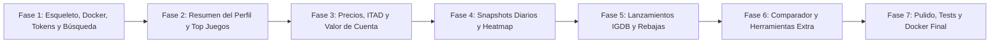

# Plan de Arquitectura e Implementación: SteamStats

> Proyecto: **SteamStats** (`steamstats.guacamolegh.es`)  
> Autor: **GuacamoleGH**  
> Repositorio: `https://github.com/GuacamoleGH/SteamStats`  
> Licencia: **MIT**  

---

## 1. Resumen Ejecutivo y Alcance

SteamStats es una aplicación web analítica de alto rendimiento para perfiles de Steam inspirada en herramientas como SteamDB y MySteamStats. Permite explorar y calcular estadísticas exhaustivas de una cuenta de Steam:
- Horas jugadas totales y recientes.
- Desglose del *Pile of Shame* (juegos comprados sin jugar).
- Nivel, XP actual, cálculo matemático del XP necesario para el siguiente nivel e insignias.
- Valor total y mínimo histórico de la biblioteca (en euros `€`, `es-ES`), coste medio por hora jugada.
- Distribuciones visuales con Recharts (por horas y por precio).
- Heatmap de actividad diaria acumulativa con capturas (*snapshots*) periódicas.
- Comparativa lado a lado entre dos perfiles.
- Calendario de próximos lanzamientos de videojuegos (vía IGDB).
- Cuenta atrás en tiempo real a las próximas grandes rebajas de Steam (`data/sales.json`).
- Herramientas auxiliares: conversor de formatos SteamID y seleccionador aleatorio de juegos de la biblioteca.

---

## 2. Arquitectura del Sistema

```
                      +---------------------------------------+
                      |       Internet / Cloudflare Tunnel    |
                      +---------------------------------------+
                                          |
                                          v
                      +---------------------------------------+
                      |         Docker Compose Host           |
                      |                                       |
                      |   +-------------------------------+   |
                      |   |    Servidor Web (Next.js)     |   |
                      |   |  - Next.js 15 App Router      |   |
                      |   |  - API Routes + Zod           |   |
                      |   |  - Server & Client Components |   |
                      |   |  - Recharts & Tailwind CSS    |   |
                      |   +---------------+---------------+   |
                      |                   |                   |
                      |                   v                   |
                      |   +-------------------------------+   |
                      |   |    Capa de Datos (Prisma)     |   |
                      |   |  - SQLite (Dev / Test)        |   |
                      |   |  - PostgreSQL (Producción)    |   |
                      |   +---------------+---------------+   |
                      |                   ^                   |
                      |                   |                   |
                      |   +---------------+---------------+   |
                      |   |    Proceso Worker Separado    |   |
                      |   |  - Tareas con node-cron       |   |
                      |   |  - Snapshots diarios horas    |   |
                      |   |  - Actualización periódica    |   |
                      |   +-------------------------------+   |
                      +---------------------------------------+
                                          |
                   +----------------------+----------------------+
                   |                      |                      |
                   v                      v                      v
        +--------------------+  +--------------------+  +--------------------+
        |   Steam Web API    |  |  IsThereAnyDeal    |  |     IGDB API       |
        |  & Storefront API  |  |    (Precios min)   |  | (Lanzamientos)     |
        +--------------------+  +--------------------+  +--------------------+
```

### 2.1. Componentes Principales
1. **Frontend / Backend Unificado (Next.js App Router):**
   - TypeScript estricto.
   - Server Components para pre-renderizado veloz y SEO con metadatos OpenGraph.
   - Client Components optimizados con hidratación ligera para gráficos Recharts y cuenta atrás en tiempo real.
   - Internacionalización base en español (`es-ES`) estructurada con diccionarios tipados para facilitar inglés futuro.
2. **Proceso Worker Autónomo:**
   - Contenedor o proceso independiente (`worker/index.ts`) ejecutado en Docker Compose.
   - Tarea programada (medianoche UTC) para registrar `OwnedGameSnapshot` de los perfiles guardados.
   - Cola interna de bajo ritmo para actualizar precios de juegos en la base de datos sin saturar la Storefront API.
3. **Capa de Persistencia (Prisma ORM):**
   - Abstracción completa de base de datos.
   - En desarrollo local: SQLite (`prisma/dev.db`).
   - En producción: PostgreSQL o SQLite montado en volumen persistente de Docker.

---

## 3. Modelo de Datos (Prisma Schema)

```prisma
datasource db {
  provider = "sqlite" // Configurable a postgresql mediante script o env
  url      = env("DATABASE_URL")
}

generator client {
  provider = "prisma-client-js"
}

// Perfil de Steam consultado y cacheado
model SteamProfile {
  steamId              String               @id // SteamID64 (ej: 76561198337759875)
  vanityUrl            String?              // ej: "GuacamoleSteam"
  personaName          String
  avatarUrl            String
  avatarMediumUrl      String?
  avatarFullUrl        String?
  profileUrl           String
  timeCreated          DateTime?
  countryCode          String?
  steamLevel           Int                  @default(0)
  totalPlaytimeMinutes Int                  @default(0)
  isPrivate            Boolean              @default(false)
  lastUpdated          DateTime             @default(now())
  createdAt            DateTime             @default(now())

  // Relaciones
  ownedGames           ProfileOwnedGame[]
  snapshots            OwnedGameSnapshot[]
  badges               ProfileBadge[]

  @@index([vanityUrl])
  @@index([lastUpdated])
}

// Relación entre un perfil y los juegos de su biblioteca
model ProfileOwnedGame {
  id                   String        @id @default(cuid())
  steamId              String
  appId                Int
  playtimeForeverMin   Int           @default(0)
  playtime2WeeksMin    Int           @default(0)
  lastPlayedTime       DateTime?
  hasPlayed            Boolean       @default(false)

  profile              SteamProfile  @relation(fields: [steamId], references: [steamId], onDelete: Cascade)
  game                 GameCache     @relation(fields: [appId], references: [appId], onDelete: Cascade)

  @@unique([steamId, appId])
  @@index([steamId])
  @@index([appId])
}

// Caché centralizada de información y precios de juegos
model GameCache {
  appId                Int                  @id // Steam AppID
  name                 String
  headerImage          String?
  isFree               Boolean              @default(false)
  isDelisted           Boolean              @default(false)
  currentPriceCents    Int?                 // En céntimos de euro (ej: 1999 = 19,99 €)
  initialPriceCents    Int?                 // Precio base antes de rebaja
  discountPercent      Int                  @default(0)
  lowestPriceCents     Int?                 // Mínimo histórico (IsThereAnyDeal)
  lowestPriceDate      DateTime?
  priceUpdatedAt       DateTime?
  createdAt            DateTime             @default(now())

  profileGames         ProfileOwnedGame[]
  snapshots            OwnedGameSnapshot[]

  @@index([priceUpdatedAt])
  @@index([name])
}

// Instantáneas diarias para generar el Heatmap de actividad
model OwnedGameSnapshot {
  id                   String        @id @default(cuid())
  steamId              String
  appId                Int
  playtimeForeverMin   Int           // Minutos totales en el momento del snapshot
  snapshotDate         DateTime      // Truncado a día YYYY-MM-DD

  profile              SteamProfile  @relation(fields: [steamId], references: [steamId], onDelete: Cascade)
  game                 GameCache     @relation(fields: [appId], references: [appId], onDelete: Cascade)

  @@unique([steamId, appId, snapshotDate])
  @@index([steamId, snapshotDate])
}

// Insignias del perfil
model ProfileBadge {
  id                   String        @id @default(cuid())
  steamId              String
  badgeId              Int
  level                Int           @default(1)
  completionTime       DateTime?
  xp                   Int           @default(0)
  scarcity             Int?

  profile              SteamProfile  @relation(fields: [steamId], references: [steamId], onDelete: Cascade)

  @@unique([steamId, badgeId])
  @@index([steamId])
}

// Lanzamientos cacheados de IGDB
model Release {
  id                   Int           @id // ID en IGDB
  name                 String
  summary              String?
  coverUrl             String?
  releaseDate          DateTime
  platforms            String        // JSON array serializado de nombres
  genres               String        // JSON array serializado de géneros
  lastUpdated          DateTime      @default(now())

  @@index([releaseDate])
}
```

---

## 4. Estructura de Carpetas del Proyecto

```
SteamStats/
├── .env.example                # Plantilla de variables de entorno seguras
├── .gitignore                  # Reglas estrictas para no filtrar datos ni secretos
├── docker-compose.yml          # Orquestación de web + worker (+ postgres opcional)
├── Dockerfile                  # Construcción multi-stage de producción
├── LICENSE                     # MIT (Autor: GuacamoleGH)
├── README.md                   # Documentación de instalación, uso y despliegue
├── package.json
├── tsconfig.json
├── tailwind.config.ts
├── postcss.config.js
├── next.config.ts
├── vitest.config.ts            # Configuración de pruebas unitarias
├── data/
│   └── sales.json              # Lista de eventos y rebajas de Steam
├── docs/
│   ├── design-system.md        # Tokens, estilos y patrones visuales
│   └── plan.md                 # Arquitectura, modelo y fases de desarrollo
├── prisma/
│   ├── schema.prisma           # Esquema de datos
│   └── migrations/             # Migraciones de base de datos
├── src/
│   ├── app/                    # Next.js App Router
│   │   ├── layout.tsx          # Layout global (Header, Footer, tema)
│   │   ├── page.tsx            # Portada: buscador hero, acceso rápido, cuenta atrás
│   │   ├── id/
│   │   │   └── [vanity]/       # Redirección/Resolución de vanity a SteamID
│   │   ├── profile/
│   │   │   └── [steamid]/      # Vista principal de estadísticas de cuenta
│   │   ├── compare/
│   │   │   └── page.tsx        # Comparativa lado a lado entre 2 perfiles
│   │   ├── releases/
│   │   │   └── page.tsx        # Calendario de lanzamientos con filtros
│   │   ├── sales/
│   │   │   └── page.tsx        # Cuenta atrás y visor detallado de rebajas
│   │   ├── tools/
│   │   │   ├── converter/      # Conversor de formatos de SteamID
│   │   │   └── random/         # Ruleta / selector aleatorio de juego
│   │   └── api/                # Rutas API internas
│   │       ├── profile/
│   │       │   ├── resolve/    # Resuelve URLs, vanity o SteamID64
│   │       │   └── [steamid]/  # Datos del perfil con caché
│   │       ├── prices/         # Precios bajo demanda con rate limit
│   │       ├── releases/       # Próximos lanzamientos desde IGDB
│   │       └── sales/          # Próximas rebajas desde sales.json
│   ├── components/
│   │   ├── ui/                 # Botones, inputs, badges, cards, modales
│   │   ├── layout/             # Header (con enlace al Hub), Footer, MobileMenu
│   │   ├── profile/            # Header de perfil, tarjetas de resumen, medallas
│   │   ├── stats/              # Top juegos, valor de cuenta, pile of shame
│   │   ├── charts/             # Gráficos Recharts (horas, precios)
│   │   ├── heatmap/            # Matriz de actividad diaria por fecha/juego
│   │   ├── releases/           # Tarjetas de lanzamiento, filtros por mes
│   │   ├── sales/              # Temporizador con días/horas/min/seg
│   │   └── tools/              # Conversor de IDs y selector aleatorio
│   ├── lib/
│   │   ├── db.ts               # Cliente Prisma singleton
│   │   ├── env.ts              # Validación de variables con Zod
│   │   ├── steam/              # Cliente Steam Web API & Storefront API
│   │   │   ├── api.ts          # Métodos Web API
│   │   │   ├── store.ts        # Precios de la tienda con colas y reintentos
│   │   │   ├── id-resolver.ts  # Parser de URL, vanity y SteamID64
│   │   │   └── xp-formula.ts   # Cálculo exacto de niveles y XP de Steam
│   │   ├── itad/               # Cliente IsThereAnyDeal API
│   │   ├── igdb/               # Cliente IGDB con autenticación Twitch OAuth
│   │   ├── sales/              # Lógica de carga y parseo de sales.json
│   │   ├── rate-limit.ts       # Rate limiting en memoria/token-bucket
│   │   └── formatters.ts       # Formato de moneda (€, es-ES), fechas y horas
│   └── types/
│       └── index.ts            # Interfaces y tipos TypeScript
├── tests/                      # Pruebas automatizadas con Vitest
│   ├── xp-formula.test.ts      # Verificación matemática de la regla de XP de Steam
│   ├── id-resolver.test.ts     # Verificación de resolución de formatos de URL/ID
│   ├── formatters.test.ts      # Verificación de números y monedas es-ES
│   └── sales.test.ts           # Verificación de lógica de cuenta atrás
└── worker/                     # Proceso autónomo de tareas programadas
    ├── index.ts                # Entrada del worker (node-cron)
    └── tasks/
        ├── daily-snapshots.ts  # Tarea de captura de horas jugadas
        └── price-updater.ts    # Actualización en segundo plano de precios
```

---

## 5. Lista de Endpoints de la API

| Método | Ruta | Descripción | Parámetros / Body |
| :--- | :--- | :--- | :--- |
| `GET` | `/api/profile/resolve` | Resuelve cualquier entrada (vanity, URL completa, SteamID) a un SteamID64 válido. | `?input=GuacamoleSteam` |
| `GET` | `/api/profile/[steamid]` | Obtiene perfil, resumen, nivel, badges y lista de juegos (aplica caché de 1h). | `?refresh=true` (con cooldown de 5 min) |
| `GET` | `/api/profile/[steamid]/heatmap` | Obtiene el histórico diario de minutos jugados para el heatmap (filtrable por `appId`). | `?appId=730` |
| `GET` | `/api/profile/compare` | Devuelve la comparativa entre dos SteamIDs (juegos en común, horas y diferencias). | `?id1=...&id2=...` |
| `GET` | `/api/prices/batch` | Consulta o actualiza precios de una lista de `appId`s respetando la cola interna. | `?appids=10,730,570` |
| `GET` | `/api/releases` | Próximos lanzamientos de videojuegos ordenados por fecha, con filtros de mes y género. | `?month=2026-11&genre=rpg` |
| `GET` | `/api/sales` | Próximas rebajas de Steam leídas de `data/sales.json` con metadatos calculados. | - |
| `GET` | `/api/tools/convert` | Convierte un identificador en SteamID64, SteamID3, SteamID2 y AccountID. | `?id=...` |

---

## 6. Análisis de Riesgos y Estrategias de Mitigación

### 6.1. Límites de Tasa de la Tienda de Steam (Storefront API)
- **Riesgo:** `store.steampowered.com/api/appdetails` tiene un límite estricto (~200 peticiones en 5 minutos). Un perfil con 500 juegos puede bloquear la IP temporalmente con respuestas HTTP 429.
- **Mitigación:**
  1. **Caché en BD con TTL de 24 horas:** La inmensa mayoría de juegos populares ya tendrán precio en `GameCache`.
  2. **Cola de procesamiento con limitador de ritmo (*token bucket*):** Peticiones en lotes pequeños (10 juegos cada pocos segundos).
  3. **Reintentos con retroceso exponencial (*exponential backoff*):** Si se detecta un HTTP 429 o 503, se detiene la cola y se reintenta tras un tiempo de espera seguro.
  4. **Degradación elegante:** Si la tienda falla, se muestran los datos existentes en caché y un aviso visual discreto sin romper la página.

### 6.2. Perfiles Privados o con Detalles de Juego Ocultos
- **Riesgo:** Si el usuario tiene `communityvisibilitystate != 3` o la opción de privacidad *"Detalles de los juegos"* en Privado/Solo amigos, `GetOwnedGames` devuelve una lista vacía.
- **Mitigación:**
  - La interfaz detectará si la visibilidad es privada o si la lista de juegos está restringida.
  - Se muestra un banner informativo claro con un botón desplegable: **"Cómo hacer público tu perfil en Steam"** con instrucciones paso a paso (Steam > Editar perfil > Configuración de privacidad > Perfil público y Detalles de los juegos: Público).

### 6.3. Juegos Gratuitos, Demos y Juegos Retirados (*Delisted*)
- **Riesgo:** Juegos gratuitos (ej: Dota 2, CS2) no tienen precio base; juegos retirados de la tienda (ej: Unreal Tournament, Rocket League en Steam) devuelven `success: false` en la API de la tienda.
- **Mitigación:**
  - Marcar juegos con flag `isFree: true` o `isDelisted: true`.
  - En la calculadora de valor:
    - Valor total contabilizado en euros.
    - Desglose explícito: *X juegos de pago (€)*, *Y juegos gratuitos*, *Z juegos sin precio en tienda (retirados o demos)*.
    - Coste por hora en 3 modalidades: *todos los juegos*, *solo juegos de pago*, *solo juegos jugados*.

### 6.4. Cuota y Disponibilidad de IsThereAnyDeal e IGDB
- **Riesgo:** Las claves de ITAD o Twitch (IGDB) pueden no estar configuradas al inicio o agotarse.
- **Mitigación:**
  - La aplicación debe funcionar perfectamente incluso si `ITAD_API_KEY` o `IGDB_CLIENT_ID` no están presentes (modo sin mínimos históricos o modo con lanzamientos estáticos de respaldo).
  - Almacenar tokens de autenticación de Twitch con gestión automática de caducidad (`expires_in`).

---

## 7. Fases de Desarrollo y Criterios de Aceptación



### Fase 1: Esqueleto del Proyecto, Docker, Sistema de Diseño y Búsqueda
- **Tareas:**
  - Configurar Next.js 15, TypeScript estricto, Tailwind CSS con los tokens de GuacamoleGH, PostCSS, ESLint, Prettier y Vitest.
  - Crear `LICENSE` (MIT, GuacamoleGH), `.env.example`, `.gitignore`, `data/sales.json` inicial.
  - Implementar Prisma con SQLite en local y cliente singleton.
  - Diseñar componentes base de layout: `Header` (con logo GuacamoleGH y enlace de vuelta al Hub `hub.guacamolegh.es`) y `Footer`.
  - Crear página de inicio con caja de búsqueda con atajo `/` o `Ctrl+K`.
  - Implementar resolución de vanity URL, URL completa o SteamID64 (`/api/profile/resolve`).
  - Redirección adecuada a `/profile/[steamid]` o `/id/[vanity]`.
  - Dockerfile y `docker-compose.yml` inicial funcional en local.
- **Criterios de Aceptación:**
  - `npm run dev` y `docker compose up` levantan la aplicación en local.
  - Al buscar `GuacamoleSteam`, `76561198337759875` o `https://steamcommunity.com/id/GuacamoleSteam`, se resuelve correctamente el SteamID64.
  - Estilos visuales perfectamente coherentes con el diseño de GuacamoleGH.

### Fase 2: Resumen del Perfil y Top de Juegos
- **Tareas:**
  - Integrar Steam Web API: `GetPlayerSummaries`, `GetSteamLevel`, `GetBadges`, `GetOwnedGames`, `GetRecentlyPlayedGames`.
  - Implementar la fórmula exacta de Steam para cálculo de nivel y XP pendiente:  
    $$\text{Coste del nivel } L = 100 \times (\lfloor L / 10 \rfloor + 1)$$
  - Construir tarjetas de métricas: Horas totales, Horas en las últimas 2 semanas, Juegos jugados vs. sin jugar (*Pile of Shame* con porcentaje), Nivel actual, Insignias y barra de progreso al siguiente nivel.
  - Tabla interactiva del Top de juegos más jugados con carátulas oficiales, horas y estado de juego.
  - Gestión visual de perfiles privados con mensaje guiado.
  - Caché de perfil de 1 hora con botón de refresco y tiempo de enfriamiento.
- **Criterios de Aceptación:**
  - El perfil de prueba muestra datos reales consistentes con Steam.
  - El cálculo de XP coincide con el perfil oficial de Steam.
  - Si el perfil es privado, la UI no falla y muestra la guía de activación.

### Fase 3: Precios, IsThereAnyDeal y Valor de la Cuenta
- **Tareas:**
  - Integrar Steam Storefront API con `cc=es` y filtro `price_overview` en euros.
  - Implementar cola de peticiones con tasa controlada, reintentos y caché de 24 horas en `GameCache`.
  - Integrar IsThereAnyDeal API para mínimos históricos.
  - Calcular valor total de la cuenta a precios actuales y a mínimos históricos.
  - Calcular coste medio por hora jugada (total, de pago y solo jugados).
  - Contabilizar y reportar juegos gratuitos y juegos sin precio (retirados).
  - Gráficas de distribución con Recharts:
    - Juegos por tramo de horas (0-1, 1-2, 2-3, 3-6, 6-12, 12-25, 25+, nunca jugado).
    - Juegos por tramo de precio actual (Gratis, <5€, 5-10€, 10-20€, 20-40€, 40-60€, 60€+).
- **Criterios de Aceptación:**
  - Valores en euros con formato oficial `es-ES`.
  - Las gráficas de Recharts son responsive y usan los colores de la paleta.
  - Tolerancia a caídas de la Store API sin bloquear la navegación.

### Fase 4: Snapshots Diarios y Heatmap de Actividad
- **Tareas:**
  - Implementar modelo `OwnedGameSnapshot`.
  - Crear proceso worker (`worker/index.ts`) con `node-cron` que tome un snapshot diario de horas jugadas por juego.
  - Endpoint `/api/profile/[steamid]/heatmap` que calcule por diferencia las horas dedicadas cada día.
  - Componente de Heatmap estilo GitHub / Steam activity con selector de año y filtro por juego individual.
  - Estado vacío (*empty state*) explicativo y atractivo para perfiles recién añadidos.
- **Criterios de Aceptación:**
  - El worker registra los snapshots programados.
  - El heatmap renderiza los días del año con celdas de intensidad de verde Guacamole.
  - Filtrar por un juego recalculando las intensidades diarias funciona instantáneamente.

### Fase 5: Calendario de Lanzamientos y Cuenta Atrás de Rebajas
- **Tareas:**
  - Integración de IGDB con Twitch OAuth y caché en base de datos.
  - Página `/releases` con próximos lanzamientos: portadas, fechas, plataformas, géneros y filtros por mes.
  - Botón "Me interesa" que guarda los juegos seleccionados en `localStorage`.
  - Módulo de rebajas (`/sales` y widget en portada) que lee `data/sales.json`.
  - Temporizador dinámico en tiempo real (días, horas, minutos, segundos) calculando el inicio a las 10:00 AM Pacífico (19:00 España peninsular).
- **Criterios de Aceptación:**
  - Cuenta atrás precisa y adaptada a la zona horaria del usuario.
  - Archivo `data/sales.json` fácilmente editable para añadir futuras rebajas.
  - Lista de lanzamientos con portadas nítidas y filtros reactivos.

### Fase 6: Comparador de Perfiles y Herramientas Extra
- **Tareas:**
  - Página `/compare`: selección de dos perfiles, juegos compartidos en común, horas de cada uno, juegos exclusivos de cada biblioteca.
  - Herramienta `/tools/converter`: conversión bidireccional entre SteamID64, SteamID3, SteamID2 y AccountID.
  - Herramienta `/tools/random`: ruleta interactiva para elegir un juego aleatorio de la biblioteca (con filtros: "solo no jugados", "juegos de menos de 10 horas", etc.).
- **Criterios de Aceptación:**
  - Comparativa clara y visual de dos cuentas.
  - Conversión matemática exacta de identificadores de Steam comprobada con tests.
  - Selector aleatorio fluido y entretenido.

### Fase 7: Pulido, Accesibilidad, Tests y Despliegue en Servidor
- **Tareas:**
  - Auditoría de accesibilidad WCAG AA: navegación completa por teclado, contrastes, etiquetas `aria-*`.
  - Suite de tests con Vitest: lógica de negocio, fórmulas de XP, conversión de IDs, cálculo de costes y rebajas.
  - Optimización de Docker Compose (servidor web + worker + healthcheck).
  - Documentación exhaustiva en `README.md`: variables de entorno, configuración de Cloudflare Tunnel y comandos de despliegue.
  - Verificación final de commits y mensaje resumen.
- **Criterios de Aceptación:**
  - Todos los tests unitarios pasan al 100%.
  - Cero warnings de TypeScript y ESLint.
  - Docker Compose levanta limpiamente sin errores en consola.
